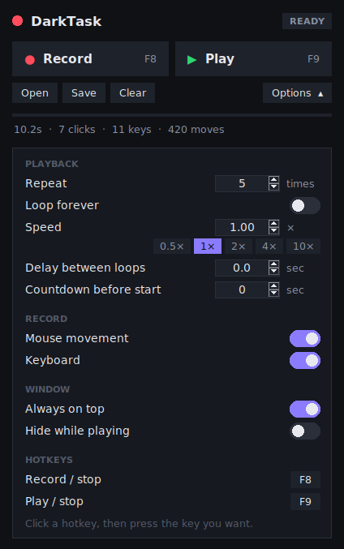
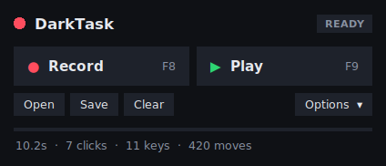

# DarkTask

A dark-mode macro recorder, like TinyTask. Hit **Record**, do something with
your mouse and keyboard, hit **Stop**, then **Play** it back once, a set number
of times, or forever.

<p>
  
  &nbsp;
  
</p>

## Get it (Windows)

1. Open the repo's **Actions** tab on GitHub and click the newest green
   **Build DarkTask** run.
2. Under **Artifacts**, download **DarkTask-windows** and unzip it.
3. Double-click **DarkTask.exe**. Nothing needs installing.

Windows may show *"Windows protected your PC"* because the app isn't signed.
Click **More info → Run anyway**.

> Tagging a commit `v1.0.0` (or any `v*`) also attaches `DarkTask.exe` to a
> GitHub Release, which gives you a permanent download link.

## How to use it

| Key  | What it does |
|------|--------------|
| **F8** | Start recording / stop recording |
| **F9** | Start playing / stop playing |

The hotkeys work while DarkTask is minimised or behind other windows. Clicks on
DarkTask itself (like its Stop button) are never recorded.

1. Press **F8** and do the thing you want repeated.
2. Press **F8** again to stop.
3. Press **F9** to play it back. Press **F9** again to stop at any time.

Your last recording is kept when you close DarkTask. Use **Save** / **Open**
to keep as many macros as you like (they're small `.json` files).

## Features

- Records mouse movement, clicks (left, right, middle, side buttons), scrolling and keyboard
- Replays with the original timing
- **Repeat** a set number of times, or **Loop forever**
- **Speed** from 0.25× to 100×, with quick 0.5× / 1× / 2× / 4× / 10× buttons
- **Delay between loops**
- **Countdown before start**, so you have time to switch windows
- Record **clicks only** by turning off *Mouse movement*, which gives fast, precise click macros
- Turn off *Keyboard* to record just the mouse
- **Always on top** and **Hide while playing**
- **Change the hotkeys**: click one in Options and press any key
- **Compact mode**: click *Options* to fold the panel away
- Never leaves a key or mouse button stuck down, even if you stop halfway through
- Handles Windows display scaling (125%, 150%, …) so clicks land where you recorded them
- Dark title bar on Windows 10 and 11

## Tips

- **Playback uses screen positions.** Keep windows where they were when you
  recorded, and don't change screen resolution or scaling in between.
- **Games or apps running as administrator** ignore input from normal apps.
  Right-click DarkTask.exe → *Run as administrator* to control them.
- Some games read the mouse at a low level and may ignore replayed mouse
  movement. Clicks and keys usually still work.

## Run from source

Needs [Python 3.8+](https://www.python.org/downloads/). Tick *"Add python.exe
to PATH"* when you install it.

- **Windows:** double-click `Start DarkTask.bat`.
- **Anywhere:**
  ```
  pip install -r requirements.txt
  python darktask.py            # or: python darktask.py mymacro.json
  ```

It also runs on macOS (allow it under *System Settings → Privacy & Security →
Accessibility* and *Input Monitoring*) and on Linux with X11 (not Wayland).

To build the `.exe` yourself on Windows:

```
pip install -r requirements.txt pyinstaller
pyinstaller --onefile --windowed --name DarkTask --icon assets/darktask.ico --hidden-import pynput.keyboard._win32 --hidden-import pynput.mouse._win32 darktask.py
```

Tests: `python -m unittest discover -s tests`

## Macro file format

```json
{
  "app": "DarkTask", "version": 1, "platform": "win32", "duration": 4.2,
  "events": [
    [0.51, "move", 640, 360],
    [0.73, "click", 640, 360, "left", true],
    [0.81, "click", 640, 360, "left", false],
    [1.20, "scroll", 640, 360, 0, -1],
    [1.64, "key", {"vk": 72, "char": "h"}, true],
    [1.70, "key", {"vk": 72, "char": "h"}, false]
  ]
}
```

Times are seconds from the start of the recording. Settings are stored in
`%APPDATA%\DarkTask` on Windows (`~/.config/DarkTask` on Linux,
`~/Library/Application Support/DarkTask` on macOS).
